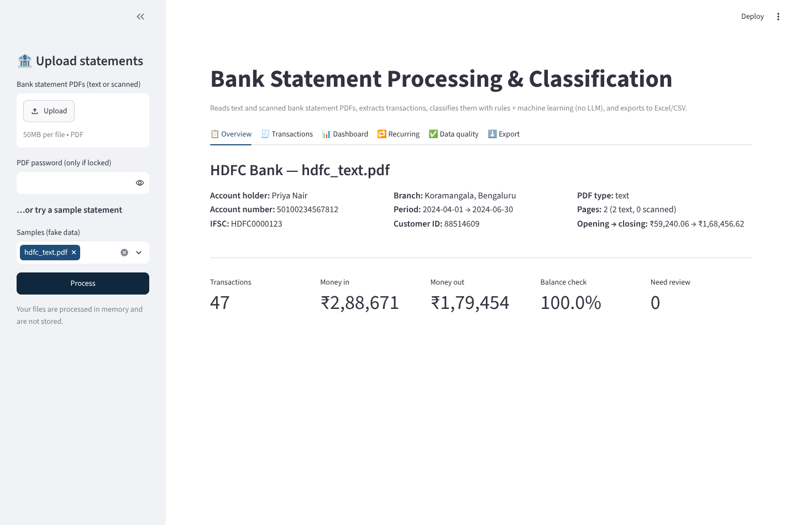
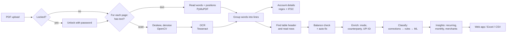

# 🏦 Bank Statement Processing & Classification System

A working prototype that reads **bank statement PDFs (text-based and scanned)**, extracts the
**account details and every transaction**, **classifies each transaction without any LLM**
(keyword rules + a traditional machine learning model), and exports the result to **Excel and CSV**.

**🔗 Live demo:** _add your Render link here after deploying (see [Deploy](#-deploy-get-a-live-link))_

Built for the Befree AI & Automation Internship assessment.



---

## ✨ Features

| Requirement | How it's done |
|---|---|
| Upload PDF statements | React web app (drag & drop, several files at once) + a command line tool |
| Text **and** image PDFs | Each **page** is checked: has real text → read directly (PyMuPDF); no text → OCR (Tesseract) |
| Auto-detect PDF type | Reports `text`, `image` or `mixed` (some pages text, some scanned) |
| Multiple banks / layouts | Layout-independent parser: finds the table header and reads columns by position. Tested on SBI, HDFC, ICICI, Axis, Kotak layouts |
| Account details | Holder name, account number, IFSC, branch, customer ID, statement period, opening/closing balance |
| Bank detection | From the IFSC code prefix (SBIN, HDFC, ICIC, UTIB, KKBK, …) with a fallback to the bank name |
| Transactions | Date, value date, description, reference no., debit, credit, balance |
| Classification **without LLM** | 1) user corrections → 2) keyword rules → 3) TF-IDF + Logistic Regression |
| Export | Formatted Excel with 7 sheets, and CSV |

### Extra features
- ✅ **Balance check** – every row must satisfy `previous balance − debit + credit = balance`. Wrong rows are flagged and a single misread balance is **auto-corrected** when the next row proves the right value.
- 🎯 **Confidence score** for every category, low-confidence rows are marked **Needs review**.
- 📈 **Model insights** – accuracy on synthetic data the model never trained on (a real held-out 20% split, same methodology as `scripts/generate_training_data.py`), so it's honest rather than a number that always looks good (see `backend/ml_eval.py`).
- 🧠 **Learns from you** – change a category in the table, press *Save*, the model retrains with your corrections.
- 🔒 **Password-protected PDFs** (common for Indian bank e-statements).
- 📚 **Several statements at once** – merged, sorted, and duplicate rows from overlapping periods removed.
- 📊 **Dashboard** – spending by category, money in vs out per month, balance over time, top merchants.
- 🔁 **Recurring payments** – salary, rent, EMIs, SIPs and subscriptions detected automatically.
- 🧾 **Clean descriptions** – payment mode (UPI / NEFT / IMPS / ATM / Card / NACH …), counterparty, UPI ID and reference number pulled out of messy narrations.
- 🧪 **33 automated tests** running on GitHub Actions.

### Edge cases handled
- Descriptions that wrap onto 2–3 lines
- Dates in many formats: `01/04/2024`, `01-04-24`, `01 Apr 2024`, `01-Apr-2024`, `2024-04-01` …
- Separate Debit/Credit columns **or** one Amount column with `Dr`/`Cr`
- Indian number format `1,23,456.78`, `Cr`/`Dr` suffixes, negative balances (overdraft)
- Serial-number column before the date, value-date column before or after the description
- Table headers not repeated on later pages
- Scanned pages that are slightly tilted or noisy (deskew + denoise before OCR)
- OCR mistakes: split numbers (`1,29, 704.46`), `O`→`0`, `§`→`5`, IFSC misread (`SBING001234` → `SBIN0001234`), wrong month in a date
- Summary lines (opening/closing balance, page numbers, totals) are ignored
- Duplicate rows, rows out of date order, rows outside the statement period are reported

---

## 🧭 How it works



### Classification (no LLM)
1. **User corrections** – if you already corrected this kind of transaction, that answer is used (confidence 100 %).
2. **Keyword rules** – about 160 keywords in 20 categories, e.g. `SWIGGY` → Food & Dining, `NACH`/`EMI` → EMI & Loans. Some rules only apply to money in (Salary, Refund, Interest) or money out (Charges, ATM). Confidence 95 %.
3. **Machine learning** – the description is cleaned (`UPI/DR/4123…/CAFE COFFEE DAY/…` → `UPI DR CAFE COFFEE DAY …`) and turned into numbers with **TF-IDF** on words *and* character n-grams (so OCR typos still match). A **Logistic Regression** model predicts the category and its probability. Below 60 % → *Needs review*; below 30 % → *Others*.

**Categories:** Salary, Food & Dining, Groceries, Shopping, Transport & Fuel, Travel, Bills & Utilities, Entertainment & Subscriptions, Healthcare, Education, Investments, Insurance, Rent, EMI & Loans, ATM Withdrawal, Transfers, Bank Charges, Interest, Refunds & Cashback, Taxes, Others.

### Results on the sample statements

| Sample | PDF type | Transactions | Balance check |
|---|---|---|---|
| SBI, HDFC, ICICI, Axis, Kotak | text | 47–54 each | **100 %** |
| Axis (password protected) | text | 54 | **100 %** |
| ICICI (page 1 text, rest scanned) | mixed | 53 | **100 %** |
| HDFC scanned | image | 47 | **100 %** |
| SBI scanned | image | 48 | 97.9 % (1 OCR digit misread – flagged for review) |

ML model (run `python -m scripts.generate_training_data`): ~99 % on a held-out test split of the synthetic data, and **8 / 10 on merchants the model has never seen** (e.g. *Cafe Coffee Day*, *Wellness Pharmacy*, *Essar Petrol Pump*). The second number is the honest one – synthetic data is easier than real life, which is why rules come first and users can correct the model.

---

## 🛠 Tech stack

| Purpose | Library |
|---|---|
| PDF text, page rendering, passwords | PyMuPDF |
| OCR | Tesseract (pytesseract) |
| Image cleanup before OCR | OpenCV |
| Data handling | pandas |
| Machine learning | scikit-learn (TF-IDF + Logistic Regression) |
| Excel export | openpyxl |
| Web API | FastAPI, uvicorn |
| Web frontend & charts | React (Vite), Recharts |
| Sample PDFs | ReportLab, pypdf |
| Tests / CI | pytest, GitHub Actions |

---

## 📁 Project structure

```
bank-statement-classifier/
├── backend/
│   ├── main.py                 # FastAPI app setup, router mounting
│   ├── routers/statements.py   # process, corrections, export, model/insights
│   ├── json_safe.py            # DataFrame/numpy -> JSON-safe dicts
│   └── ml_eval.py              # honest held-out-split accuracy for Model insights
├── frontend/                   # React (Vite) web app
│   └── src/
│       ├── App.jsx             # top-level state: upload, process, tabs
│       ├── theme.jsx           # light/dark context provider
│       ├── api.js              # fetch wrappers for the backend API
│       ├── insights.js         # client-side chart/summary aggregation
│       └── components/         # Sidebar, Header, Tabs, one file per tab
├── cli.py                     # command line version
├── src/
│   ├── pdf_reader.py          # open/unlock PDF, detect text vs scan, OCR
│   ├── layout.py              # group words into lines
│   ├── account_parser.py      # account details + bank detection
│   ├── transaction_parser.py  # find header, read rows, debit/credit
│   ├── validator.py           # balance check, duplicates, date checks
│   ├── enrich.py              # mode, counterparty, UPI ID, reference
│   ├── insights.py            # recurring, monthly, categories, merchants
│   ├── exporter.py            # Excel (7 sheets) + CSV
│   ├── pipeline.py            # runs all the steps in order
│   ├── utils.py               # date and amount parsing
│   └── classifier/
│       ├── categories.py      # the category list
│       ├── rules.py           # keyword rules
│       ├── ml_model.py        # TF-IDF + Logistic Regression
│       └── hybrid.py          # corrections → rules → ML, confidence
├── scripts/
│   ├── synthetic.py           # realistic fake transactions
│   ├── generate_samples.py    # builds the sample PDFs
│   └── generate_training_data.py  # builds training data + evaluates model
├── data/training_data.csv     # labelled training data
├── samples/                   # 9 fake statements for the CLI/tests (text, scanned, mixed, locked)
├── tests/                     # 33 pytest tests
├── requirements.txt           # Python packages (FastAPI backend)
├── Dockerfile                 # backend-only image (Python + Tesseract) for Render
└── render.yaml                # Render Blueprint for the backend
```

---

## ▶️ Run it on your computer

1. Install **Python 3.10+**, **Node 20+**, and **Tesseract OCR**
   - Windows: installer from <https://github.com/UB-Mannheim/tesseract/wiki> (tick "Add to PATH")
   - macOS: `brew install tesseract`
   - Ubuntu: `sudo apt install tesseract-ocr`
2. Backend (FastAPI):
   ```bash
   git clone https://github.com/krunal491/bank-statement-classifier.git
   cd bank-statement-classifier
   pip install -r requirements.txt
   uvicorn backend.main:app --reload --port 8000
   ```
3. Frontend (React), in a second terminal:
   ```bash
   cd frontend
   npm install
   npm run dev
   ```
4. Open <http://localhost:5173> (Vite proxies `/api` to the backend on :8000), drop a bank statement
   PDF into the sidebar and press **Process**. The repo's fake statements in `samples/` work well for
   a first run (e.g. `samples/sbi_text.pdf`, or `samples/axis_locked.pdf` with password `AXIS1234`).

For a single-process local run (handy for a quick check, not how it's deployed - see below), build
the frontend once and let FastAPI serve it: `cd frontend && npm run build && cd .. && uvicorn
backend.main:app --port 8000`, then open <http://localhost:8000>.

Command line:
```bash
python cli.py samples/hdfc_text.pdf --out result.xlsx
python cli.py samples/axis_locked.pdf --password AXIS1234 --out result.csv
```

Tests: `pytest -q`

Rebuild the sample PDFs / training data: `python -m scripts.generate_samples` and `python -m scripts.generate_training_data`

---

## 🌐 Deploy (get a live link)

Frontend and backend deploy as two separate free services — **Vercel** for the React app, **Render**
for the FastAPI/OCR backend.

**1. Backend on Render:**
1. Go to <https://dashboard.render.com> and sign in with GitHub.
2. **New** → **Blueprint**, pick the `krunal491/bank-statement-classifier` repo. Render reads
   `render.yaml` and sets everything up (Docker, free plan, health check at `/api/health`). Or:
   **New** → **Web Service** → same repo → Render auto-detects the `Dockerfile`.
3. Click **Deploy**. Installs Tesseract + Python deps, so expect a couple of minutes.
4. Copy the resulting `https://<name>.onrender.com` URL.

**2. Frontend on Vercel:**
1. Go to <https://vercel.com/new> and import the same GitHub repo.
2. Set **Root Directory** to `frontend` (Vercel auto-detects the Vite framework preset from there;
   `frontend/vercel.json` pins the build command/output just in case).
3. Add an environment variable: `VITE_API_BASE_URL` = the Render URL from step 1 (no trailing slash,
   no `/api` — e.g. `https://bank-statement-classifier.onrender.com`).
4. Click **Deploy**. Copy the `https://<project>.vercel.app` link into the top of this README — that's
   the one to share.

Notes:
- Render's free plan spins the backend down after 15 minutes idle; the first request after that takes
  ~30-50s to wake back up (the frontend shows a "waking up" message during that wait, not a blank page).
- CORS on the backend is wide open (`allow_origins=["*"]`) since there's no session/auth to protect
  across the two origins.

---

## ⚠️ Limitations & next steps
- Sample statements and training data are **synthetic** (real statements contain private data). Real statements from more banks would improve both the parser and the model.
- OCR accuracy depends on scan quality; the balance check catches most OCR number errors.
- The API is stateless by design (the frontend holds the current table; nothing is persisted server-side), so corrections are shared across everyone using the app and kept only until the backend restarts - accounts + a database would make corrections private and permanent, at the cost of needing a login.
- Possible additions: per-bank layout templates, credit-card statements, Hindi/regional-language OCR, budgeting alerts.

All names, account numbers and transactions in this repository are fake.

### Upload responsiveness

The upload panel keeps its size while files are selected and processed. Existing results
stay visible during reprocessing, and the selected tab is preserved. Only one PDF (up to 20 MB) is accepted per request. Choosing another file replaces
the current selection. The CLI still supports processing multiple statements.

PDF processing runs in a worker thread so health checks stay responsive. Scanned pages
use at most two OCR workers and two rendered pages in memory at once; PyMuPDF access is
serialized across requests. Rules and saved corrections bypass ML inference, and the
Docker build trains the classifier ahead of the first upload. Scanned PDFs still require
OCR; these changes do not eliminate hosting startup delays.

Model Insights reads packaged baseline metrics instead of training during a request.
Run `python -m backend.ml_eval` after changing the synthetic training data or evaluation
code; Docker does this automatically during every build. The frontend offers a retry
if metrics cannot load within 20 seconds. These metrics describe a synthetic benchmark,
not guaranteed accuracy on uploaded statements.
